  <picture>
    <source media="(prefers-color-scheme: dark)" srcset="brand/png/rehalo-horizontal.png">
    
  </picture>

# rehalo: an open-source app for the SmartHalo 2

Website: [rehalo.app](https://rehalo.app/)

The company behind the SmartHalo 2 bike ring closed in 2021 and its servers went with it. rehalo is an
independent iPhone app that talks to the ring directly over Bluetooth, with no account and no company
servers. It was built from the published firmware source and by reverse engineering. An Android app
and App Store and Google Play releases are planned.

> **Early beta.** The app connects to a real SmartHalo 2, completes the Bluetooth handshake and reclaims
> a ring. Navigation, alarm, ring cards, light, and call and rain alerts are built but still need road
> testing.

> **Disclaimer.** Not affiliated with SmartHalo or CycleLabs. Intended for reviving **your own** device.
> No warranty: use at your own risk. Opening the case and touching the battery can damage the hardware.

## Features (iOS app)

<table>
  <tr>
    <td align="center" width="33%"></td>
    <td align="center" width="33%"></td>
    <td align="center" width="33%"></td>
  </tr>
  <tr>
    <td align="center"><b>Map</b> Search a place or open a route, then navigate.</td>
    <td align="center"><b>Routes</b> Your imported routes, with distance, climb and time.</td>
    <td align="center"><b>Halo</b> Light, alarm, ring cards and tap shortcuts.</td>
  </tr>
</table>

Screenshots from demo mode, which simulates the ring.

Everything that touches the ring runs over Bluetooth. A self-hosted server is optional. Maps, search
and directions use Apple Maps and need internet.

- **Navigation:** import a GPX route or search for a place (City, Road or Trails profile), and get
  turn guidance on the ring. Compass mode points at your destination. Includes a Live Activity and a
  3D route view.
- **Alarm:** arms when you leave and disarms when your iPhone returns, with a five-tap code on the ring.
- **Ring cards and shortcuts:** clock, battery, speed, distance, ride time and average speed, plus tap
  shortcuts for the horn, the light and quick readings.
- **Front light:** on/off, brightness, steady or blinking.
- **Call alerts:** the ring pulses and a short tap silences it. iOS gives no caller name.
- **Rain alerts:** optional. Sends your approximate location to [Open-Meteo](https://open-meteo.com/).
- **Ring recovery:** reclaim a ring whose password was lost. Passwords are kept in your Keychain.
- **Demo mode:** explore the app without a ring.

**Not implemented:** firmware updates over the air, online rerouting, app notifications on the ring,
ride recording, and Strava or Apple Health sync.

## What's in here

| Path | What |
| --- | --- |
| `clients/ios/` | The native SwiftUI app and the `SH2Protocol` Swift package. |
| `clients/linux/` | Linux Bluetooth command-line tools (`sh2-scan`, `sh2-pair`). |
| `clients/desktop/` | Electron desktop app on top of `sh2-core`. |
| `sh2-core/` | Transport-agnostic protocol core in JavaScript, with no dependencies. |
| `sh2-server/` | Optional self-hosted server for accounts and rides. |
| `emulator/` | Software model of the SmartHalo 2 that runs the recovery end to end, and a live preview of the ring and its display driven by the firmware's own code ([`emulator/README.md`](emulator/README.md)). |
| `site/` | The project website, published to GitHub Pages. |
| `docs/` | Protocol, API and app specifications. |

The Linux and desktop tools need the SmartHalo 2 firmware source to run a real recovery: point
`SH2_FIRMWARE_SRC` at your copy. The emulator's preview builds the firmware's display code from your
copy too, with `SH2_STM_FIRMWARE`.

## Install the iOS app

rehalo isn't on the App Store yet. The app is unsigned, and you sideload it with your own Apple ID.

**From SideStore or AltStore:** add the rehalo source under *Sources*, and the app installs and updates
from there.

- Releases: `https://rehalo.app/altstore/apps.json`
- Development builds, one for every push to `dev`: `https://rehalo.app/altstore/apps-dev.json`

Add one or the other, not both: they offer the same app. The [website's FAQ](https://rehalo.app/#faq-title)
has buttons that add them in one tap.

**Or get the `.ipa`:** download `rehalo-unsigned.ipa` from the
[latest release](https://github.com/cyberlynx33/open-rehalo/releases/latest), or build it yourself with
`cd clients/ios && xcodegen generate` on a Mac. The newest development build, rebuilt on every push to
`dev`, is the [dev-latest](https://github.com/cyberlynx33/open-rehalo/releases/tag/dev-latest)
prerelease.

**Install it** with [iLoader](https://github.com/nab138/iloader) over USB, or with
[SideStore](https://sidestore.io) for automatic 7-day re-signing. Then trust the certificate in
*Settings › General › VPN & Device Management*. iOS 16 and later also need *Developer Mode*.

Use a real iPhone: the simulator has no Bluetooth, though demo mode works there.

### Reclaiming your ring

Open the app, pick your SmartHalo and follow the recovery wizard. The ring has to reboot once, because
a firmware quirk keeps the old password in memory until the next boot. Plug a micro-USB cable into the
bottom of the ring and unplug it again: the ring restarts when power comes in. If that doesn't work,
drain the battery and recharge it, or disconnect the battery if you're comfortable opening the case.
There is no reboot over Bluetooth: the firmware refuses it unless an app is already paired. Use this
only on your own device.

<table>
  <tr>
    <td align="center" width="33%"></td>
    <td align="center" width="33%"></td>
    <td align="center" width="33%"></td>
  </tr>
  <tr>
    <td align="center"><b>1. Recover your Halo</b> Un-pairs the ring and creates a new password, saved in your Keychain.</td>
    <td align="center"><b>2. Reboot the Halo</b> Plug a micro-USB cable in and out again. The app notices when the ring is back.</td>
    <td align="center"><b>3. Done</b> The ring is paired with this iPhone again.</td>
  </tr>
</table>

## Self-hosted server (optional)

`sh2-server/` powers the app's server mode with accounts and ride history. It's a dependency-free Node
service: run `docker compose up -d` from that folder on any machine.

## Other clients

- **Linux:** `cd clients/linux && npm i`, then `node bin/sh2-scan.mjs` or `node bin/sh2-pair.mjs <MAC>`.
- **Desktop:** `cd clients/desktop && npm i && npm run dist` builds an AppImage.

## Security notes

- **Anyone in Bluetooth range can un-pair a SmartHalo 2.** This is how the original firmware works, and
  it's what makes recovery possible. It gives no control of the ring by itself, but it does weaken the
  ring's anti-theft protection.
- **Everything else needs pairing.** The firmware rejects light, ring, sound, alarm, name, reboot and
  battery commands unless an app is paired.

## Credits

Built on the firmware source published after SmartHalo closed, and on community work:
[kperdlich/SmartHalo](https://github.com/kperdlich/SmartHalo),
[aolde/smarthalo-api](https://github.com/aolde/smarthalo-api) and
[smarthalo-community/smarthalo-firmware](https://github.com/smarthalo-community/smarthalo-firmware).

## License

[MIT](LICENSE) for rehalo's original code. See [NOTICE.md](NOTICE.md) for what that doesn't cover.
