# SmartHalo 2 — UART recovery of the STM32

A guide for a ring with no Bluetooth advertising, one that doesn't appear in any scan. Use it only on
your own device.

If the ring does advertise, you don't need this: use the recovery wizard in the app or the Linux tools.

## Your options

This is one option, next to three simpler ones:

1. **Plug in a micro-USB cable** on the bottom of the ring and unplug it again. The ring restarts when
   power comes in. No tools needed.
2. **Drain the battery** and recharge it. No tools needed either, but it takes a while.
3. **Disconnect the battery** for about 10 s and reconnect it. You have to open the case, but there's
   no soldering.
4. **Use the UART console**, described here. It needs soldering, but it lets you delete the saved state
   directly.

<p align="center"></p>

Try the first three before opening a serial console. If a reboot doesn't bring Bluetooth back, the saved
state below is the likely reason.

## Why a ring can stop advertising

A ring **paired and left in a saved armed/standby state** keeps its BLE chip (nRF52832) **unpowered**:
the STM32 holds `BLE_EN` low. To confirm this, run several scans, including a raw one such as
`btmgmt find` as root. Nothing appears.

The anti-theft tap code (tapped on the CENTER) **does disarm** the alarm, but it **doesn't turn BLE back
on**. That step (`toggleStandby(StandbyOff)` in `AlarmTask.c`) only runs if the `armedMode` flag is set,
and that flag is only set by arming **while connected over BLE**, so without a connection you can't
reach it.

The state lives in the **STM32's external SPIFFS flash**, reachable through its **UART debug console
(USART1)**, which provides `ls`, `xxd`, `rm`, `reboot` and more.

## What you need

- **3.3 V USB-UART adapter** (CP2102 / CH340 / FT232RL). It must run at **3.3 V** (jumper or 3.3 V
  mode): **never 5 V to the STM32**. ~€4-7.
- **Opening kit** (plastic picks/pry tools) + a hair dryer to soften the adhesive. ~€5.
- **Fine-tip soldering iron** + 0.5 mm solder + flux (you'll almost certainly have to solder 3 thin
  wires). ~€15-25.
- **Multimeter** with continuity (to find GND and trace pads). ~€10.
- *(Optional)* USB logic analyzer (~€8) to find the TX pad by its activity at boot.

## Connection

Console = **USART1**, **115200 8N1**, STM32 pins:
- **PA9 = STM32 TX** → goes to the **adapter's RX**.
- **PB7 = STM32 RX** → goes to the **adapter's TX**.
- Common **GND**.

The pads aren't documented (the SH2 schematic was never released). To find them:
1. GND: with the multimeter, check continuity against the shield / battery negative / USB shell.
2. TX (PA9): the firmware **prints a banner on USART1 at boot**. Connect the **adapter's RX** to each
   candidate pad (common GND), open a terminal at 115200 and **restart** the device (plugging in USB =
   reboot). The pad that outputs **readable text** is TX.
3. RX (PB7): usually next to TX; you confirm it when you can type commands.

Terminal (on the PC, with the adapter plugged in; it appears as `/dev/ttyUSB0` or `/dev/ttyACM0`):
```
# install one: picocom / minicom / tio
picocom -b 115200 /dev/ttyUSB0
# or:  tio -b 115200 /dev/ttyUSB0
```

## Command sequence (on the SmartHalo console)

```
help                 # list available commands (confirms the console responds)
ls                   # list files on the external flash (you'll see AlarmConfig, StandbyState, ArmedMode…)
xxd AlarmConfig      # (optional) dump the file -> first byte = tap code, 2nd = length
rm StandbyState      # <-- key step: delete the armed/standby state that keeps BLE off
rm ArmedMode         # just in case, delete the armed flag
reboot               # restart -> boots WITHOUT standby -> the nRF gets power -> BLE ON
```

> `rm AlarmConfig` would also delete the tap code (leaving the device with no code). It's optional;
> `rm StandbyState` + `rm ArmedMode` are enough to turn BLE on.
> Deleting these files is **reversible** (the firmware recreates default values). It doesn't touch the
> bootloader or the firmware.

## After BLE is on

1. The SmartHalo starts advertising `smarthalo` / company `0x0466`.
2. On the PC (see the main README for `SH2_FIRMWARE_SRC`):
   ```
   cd clients/linux
   node bin/sh2-scan.mjs 20        # find its MAC
   node bin/sh2-pair.mjs <MAC>     # reset challenge + re-pair with a new password
   ```
3. From there, you have full BLE control with `sh2-core` (light, alarm, etc.).

## Alternative: STM32 SWD

If you can't find or enable the UART, an **ST-Link** (~€3) + OpenOCD gives SWD access to the STM32 to
dump or erase the external flash or force the state. It's more involved than the UART; use it only if
the serial console doesn't respond.
